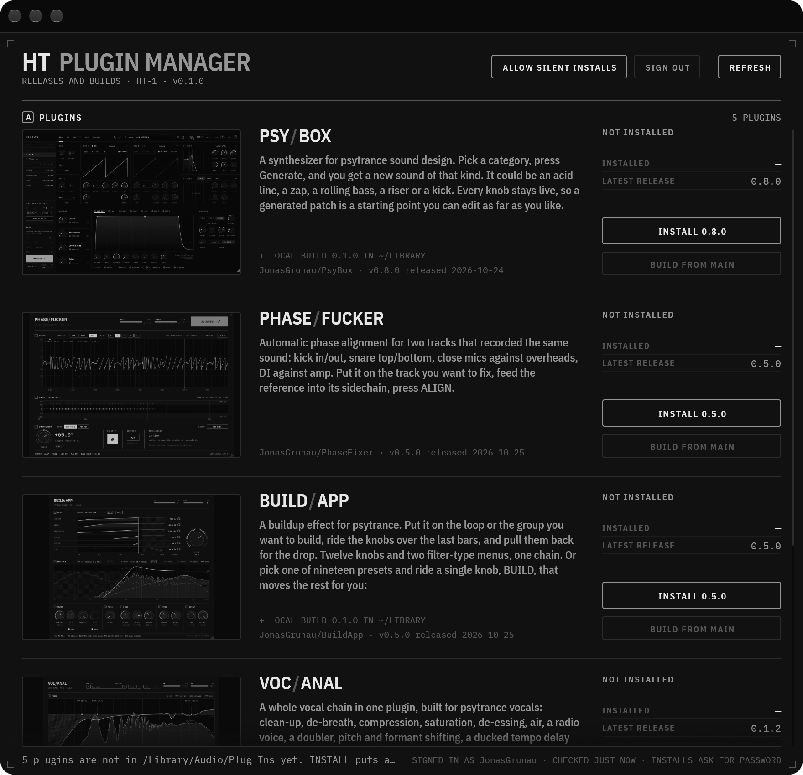

# HT Plugin Manager

All your plugins in one place: PsyBox, PhaseFucker, BuildApp, VocAnal and DisTitten. Sign in with GitHub once and it lists every plugin repo on the whitelist that your account can see. For each one it compares the latest release with what is installed and installs the update without an installer wizard. **BUILD FROM MAIN** builds the current `main` on your computer and installs that instead. Runs on macOS and Windows.



```sh
./start.sh
```

That builds the app, signs it with the plugins' Developer ID and opens it. Logs stay in the terminal.

## Signing in

**SIGN IN WITH GITHUB** uses GitHub's device flow. It opens github.com/login/device, copies the one-time code to your clipboard, and waits while you approve. The token goes into the macOS keychain or the Windows Credential Manager (`de.grunau.ht-plugin-manager`), so the next start skips the sign-in. **SIGN OUT** deletes it.

The device flow needs a GitHub OAuth app. Register it once:

1. GitHub → Settings → Developer settings → OAuth Apps → **New OAuth App**. Name `HT Plugin Manager`; homepage and callback URL can both be `https://github.com/JonasGrunau`.
2. Tick **Enable Device Flow** and save.
3. Copy the **Client ID**. It is not a secret. Put it in the repo variable `HTPM_GITHUB_CLIENT_ID` for release builds, and export it before `./start.sh` for local ones. Or set `github_client_id` in the config file below.

Until then the sign-in page shows only **USE GH CLI LOGIN**, which takes the token of your `gh auth login` session.

Only repos the signed-in account can see are listed. When a collaborator without access to, say, BuildApp signs in, BuildApp is simply not there. No error.

## Installing without installer windows

**macOS.** Releases install from their signed `<Product>-<version>-macOS.pkg` through `installer -pkg … -target /` into `/Library/Audio/Plug-Ins`. `/Library` needs root, so on first start the app asks for your password once (**ALLOW SILENT INSTALLS** in the header asks again if you cancelled). It uses that password to install two things:

- `/Library/PrivilegedHelperTools/de.grunau.ht-plugin-manager.helper`, a root-owned script with two jobs:
  - install a pkg, but only if Gatekeeper accepts it as notarized and signed by Developer ID team `JQ4STVWTQ3`;
  - copy a locally built `.vst3` / `.component` into `/Library/Audio/Plug-Ins`.
- `/etc/sudoers.d/ht-plugin-manager`, which lets your user run that one script without a password. It is checked with `visudo -c` before it goes live.

After that every signed release installs silently. A pkg not signed by the team still installs, after the standard macOS password prompt. After each install the app restarts `AudioComponentRegistrar`, so hosts see the new Audio Unit without a reboot. To undo the setup:

```sh
sudo rm /etc/sudoers.d/ht-plugin-manager /Library/PrivilegedHelperTools/de.grunau.ht-plugin-manager.helper
```

**Windows.** Releases install from their `<Product>-<version>-Windows-Setup.exe` with `/VERYSILENT`, so no wizard pages; the VST3 lands in `C:\Program Files\Common Files\VST3`. Windows has no equivalent of the sudoers rule, so each install shows one UAC prompt.

## Building main

**BUILD FROM MAIN** makes a shallow checkout of the exact commit in the app's data folder, configures it with CMake, builds the plugin targets and installs the bundles. On macOS that is Ninja, VST3 and AU. On Windows it is Visual Studio and VST3 only. When `~/Projects/open_music_analyzer/plugin/third_party/JUCE` exists it is used instead of a download; PhaseFucker then builds in about 40 s. The build log goes to `~/Library/Logs/HT Plugin Manager/` or `%LOCALAPPDATA%\HT Plugin Manager\logs`. If a build fails, click the FAILED line to open the log.

A build of main shows as **BUILD OF MAIN** with its commit. As soon as a release newer than that commit comes out, the row offers the update again.

## `ht-plugin-manager.json`: the plugin manifest

Every plugin repo keeps this file at its root. The app reads it from the default branch:

```json
{
  "schema": 1,
  "name": "PhaseFucker",
  "category": "Linear-phase alignment",
  "description": "One or two sentences for the list.",
  "image": "docs/screenshot.png",
  "bundles": ["PhaseFucker.vst3", "PhaseFucker.component"],
  "build": {
    "cmake_args": ["-DPHASEFUCKER_BUILD_TESTS=OFF", "-DPHASEFUCKER_COPY_PLUGIN=OFF"],
    "targets": ["PhaseFucker_VST3", "PhaseFucker_AU"],
    "artefacts": "PhaseFucker_artefacts/Release"
  }
}
```

| Field | What it does |
|---|---|
| `name` | Product name. The list sets it as a `LEFT/RIGHT` wordmark split at the second capital (`PHASE/FUCKER`) |
| `category` | A few words on what it does; the caption under the name |
| `description` | The text in the list; four lines fit |
| `image` | Product picture: a path in the repo (fetched with your token, so private repos work) or an `https://` URL |
| `bundles` | Bundle file names, used to find the installed version (Info.plist on macOS, the VST3's `moduleinfo.json` on Windows) |
| `build` | Extra CMake flags, the targets for BUILD FROM MAIN, and where they put their bundles (`<artefacts>/VST3`, `<artefacts>/AU`). `_AU` targets and `.component` bundles are skipped on Windows |

Every field except `name` has a default. A repo without the file still shows up: the app takes the README's title, first paragraph and first image.

## Configuration

`config.json` is written on first start, to `~/Library/Application Support/HT Plugin Manager/` on macOS and `%APPDATA%\HT Plugin Manager\` on Windows:

```json
{
  "github_client_id": "",
  "whitelist": ["JonasGrunau/PsyBox", "JonasGrunau/PhaseFucker", "JonasGrunau/BuildApp", "JonasGrunau/VocAnal", "JonasGrunau/DisTitten"],
  "juce_dir": "",
  "helper_offered": false
}
```

Add a plugin by adding its `owner/repo` to `whitelist` and pressing **REFRESH**.

## Releases

```sh
git tag v0.2.0 && git push origin v0.2.0
```

`.github/workflows/release.yml` then builds and publishes two files:

- `HT-Plugin-Manager-<v>-macOS.dmg`: a universal (arm64 + x86_64) app, signed with the plugins' Developer ID, notarized and stapled.
- `HT-Plugin-Manager-<v>-Windows-Setup.exe`: Inno Setup, installs per user without an admin prompt.

The tag version goes into the app. A tag with a suffix (`v0.2.0-beta.1`) becomes a pre-release, and running the workflow by hand builds both files without releasing them. The workflow needs the same four signing secrets as the plugin repos: `MACOS_CERTIFICATES_P12`, `MACOS_CERTIFICATES_PASSWORD`, `NOTARY_APPLE_ID`, `NOTARY_PASSWORD`. Set them with the audio-plugin skill's `set-signing-secrets.sh`. Without them the DMG is signed ad hoc and not notarized.

Locally, the same DMG:

```sh
scripts/bundle.sh --universal --dmg --notarize   # notary login comes from 1Password the first time
```

## Development

```sh
cargo test                                   # unit tests
HTPM_TOKEN=$(gh auth token) cargo test --release -- --ignored builds_main   # real build of PhaseFucker main
HTPM_TOKEN=$(gh auth token) HTPM_SNAPSHOT=/tmp/ht.png ./target/release/ht-plugin-manager   # screenshot of the sheet
HTPM_SNAPSHOT_STATE=busy …              # same, with an update, a build and a failure staged
HTPM_SNAPSHOT_STATE=signed-out …        # the sign-in page, without touching the stored login
HTPM_SNAPSHOT_SIZE=1600x1100 …          # in a bigger window
python3 scripts/make-icon.py                 # redraw assets/AppIcon.{icns,ico,png}
```

The UI follows the house style of the audio-plugin SDK (`~/Projects/audio-plugin-sdk`, `references/ui-design.md`) in a monochrome palette of its own called graphite. The rules are in `AGENTS.md`.
